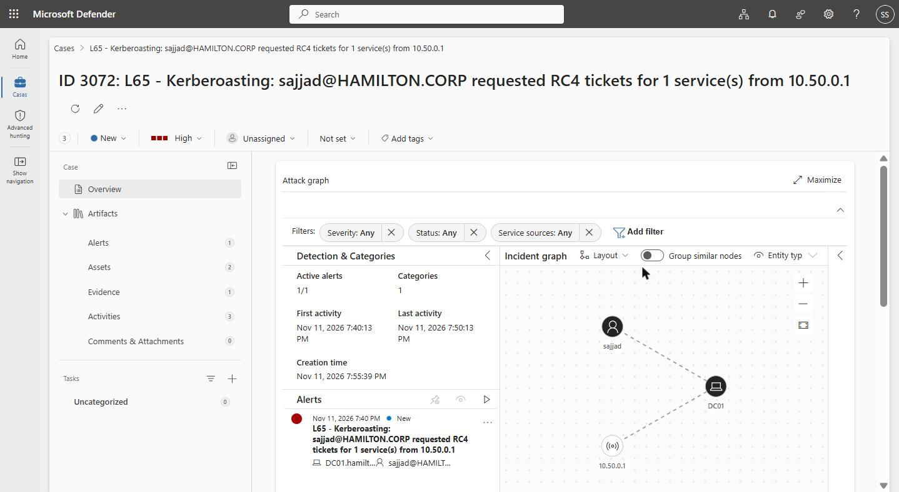

# Mission 4 — DFIR report: the service account `svc-app65` on WKS-L65

**Analyst:** Sajjad · **Host:** `WKS-L65.hamilton.corp` (seat 65) · **Domain:** `hamilton.corp`
**Date of investigation:** 2026-11-02 · **Evidence:** my own Microsoft Sentinel workspace (`SecurityEvent`), plus artifacts recovered from the host. All times UTC (local = UTC+2).

> An alert-style tasking said a service account had been used on my workstation. This report reconstructs, from my own monitoring and the host, what that account did: what it took, and whether it is still inside.

---

## 1. Executive summary — for a manager

A background service account — one that should never sign in to a desktop — was used on my workstation during the afternoon of 2 November 2026 as if a person had taken it over. Over roughly three hours it looked around the machine, gathered a small set of **customer records** (names, emails, subscription plan and monthly revenue) and left them bundled on the machine ready to carry off, and it set up a **scheduled task that runs every fifteen minutes** so the intruder keeps a foothold even after the session ends. The most important point for a decision-maker: **this incident is not over** — the way back in is still active and re-runs on its own, and a set of customer personal and commercial data was staged for theft, which makes this a reportable data incident. The root cause was the service account's password being stolen offline (Kerberoasting) before the window I can see; that is addressed in remediation.

---

## 2. Technical narrative — for a technician

**Stage 0 — how the account was stolen (root cause, not in my Sentinel).** The account `svc-app65` is a domain service account that advertises a service via a Service Principal Name (`MSSQLSvc/app65.hamilton.corp`). Any domain user can request a Kerberos service ticket for such an account; that ticket is encrypted with the account's own password and can be cracked offline with no failed logons and no alarm. This step happens at the domain controller, which my workstation's monitoring does not see, so I reason it rather than prove it — but it is the only explanation for an attacker holding this account's password. *How I know the account is Kerberoastable:* it carries an SPN (confirmed on the host with `setspn -L svc-app65`).

**Stage 1 — the logon that should not exist (2026-11-02 13:45:40 UTC).** `svc-app65` signed on to `WKS-L65` as a **batch logon (LogonType 4)** — the shape of a scheduled task running under stored credentials, not a human and not a normal service on this box. It logged on 17 times between 13:45 and 16:30, which already hints at something re-triggering on a schedule. A service account interactively present on a workstation is the anomaly that anchors the whole timeline. *How I know:* Sentinel `SecurityEvent`, EventID 4624, `TargetUserName == "svc-app65"` (queries.kql Q1).

**Stage 2 — what the account did (2026-11-02 13:45:41–42 UTC).** Immediately after the first logon, a single `powershell.exe` session spawned a tight burst of reconnaissance: `whoami` and `whoami /all` (who am I, what privileges), `net user svc-app65` (inspect its own account), `net localgroup administrators` (am I a local admin?) and `ipconfig /all` (the network layout). This is a human orienting themselves, not a service doing its job. *How I know:* Sentinel `SecurityEvent`, EventID 4688 with full command line, filtered to `svc-app65` (queries.kql Q2).

**Stage 3 — the data it gathered and staged (2026-11-02 14:45:42 UTC).** The account collected customer data into `C:\Users\Public\Desktop\staging\`: a `customers.csv` holding customer identifiers, full names, email addresses, subscription plan and **monthly recurring revenue**, explicitly tagged with an exfiltration marker, alongside a small proof file. Note that the collection command itself does **not** appear as its own process event — it was run as a PowerShell cmdlet inside the existing session, so no new process was created. The proof is therefore the result left on disk, which I recovered from the host. *How I know:* the staged files on the host, timestamped inside the attack window; the surrounding process timeline in Sentinel (Q2) places the session there.

**Stage 4 — the way it left itself back in (persistence, active).** The account created **two scheduled tasks**, both running as `HAMILTON\svc-app65` with a stored password:
- `M4-SvcApp65-Persistence` — triggers **every 15 minutes** and appends a beacon line to `C:\ProgramData\m4-persistence-log.txt`. This is the metronome seen in Stage 1/2 (a new process on every quarter-hour) and the reason the logon count kept climbing.
- `M4-SvcApp65-Session` — an on-demand task configured to run a PowerShell payload script (`C:\ProgramData\m4_session_payload.ps1`) with `-ExecutionPolicy Bypass`, i.e. a second, hands-on foothold. The referenced script was **not present on disk** at the time of investigation: the task is armed to execute a payload that is dropped (or re-dropped) when the operator chooses, so the absence of the file now does not neutralise the task — the task entry itself is the persistence.

Critically, **the scheduled-task creation left no EventID 4698 in my Sentinel** — my workspace never recorded the persistence being set up (queries.kql Q4 returns nothing). I found the tasks by inspecting the Task Scheduler store on the host directly. *How I know:* the task definition files under `C:\Windows\System32\Tasks\` (recovered on the host), and the beacon log growing by one line every 15 minutes.

---

## 3. MITRE ATT&CK mapping

| Stage | Tactic | Technique (ID + name) | What I observed | Where I can prove it |
|---|---|---|---|---|
| 0 — root cause | Credential Access | **T1558.003** Steal or Forge Kerberos Tickets: Kerberoasting | A service account with an SPN whose password the attacker already held | Reasoned — happened off my workstation (domain controller); SPN confirmed on host with `setspn` |
| 1 — initial access | Initial Access / Defense Evasion | **T1078.002** Valid Accounts: Domain Accounts | `svc-app65` batch logon (type 4) to WKS-L65, 17× in the window | My Sentinel: `SecurityEvent` 4624, `svc-app65` (queries.kql Q1) |
| 2 — execution / discovery | Execution + Discovery | **T1059.001/003** Command & Scripting Interpreter; **T1033**, **T1087.001**, **T1069.001**, **T1016** (owner/account/group/network discovery) | `whoami /all`, `net user`, `net localgroup administrators`, `ipconfig /all` from one PowerShell session | My Sentinel: `SecurityEvent` 4688 with command line (queries.kql Q2) |
| 3 — collection / staging | Collection | **T1005** Data from Local System; **T1074.001** Local Data Staging | Customer records gathered into `...\Public\Desktop\staging\customers.csv` | Staged files recovered on host; timeline corroborated in Sentinel (Q2). Cmdlet itself produced no 4688 — reasoned from the file on disk |
| 4 — persistence | Persistence | **T1053.005** Scheduled Task/Job: Scheduled Task | Two tasks as `svc-app65`: a 15-minute beacon and an on-demand PowerShell payload | Task files under `C:\Windows\System32\Tasks\` on host. **Gap:** no 4698 in my Sentinel (queries.kql Q4 empty) |

---

## 4. Impact and containment

- **What was taken.** A set of **customer records** was collected and staged for exfiltration: customer ID, full name, email address, subscription plan and monthly recurring revenue, carrying an explicit exfiltration marker. The recovered sample is small (a handful of rows), but the content type is customer personal data combined with commercial/revenue information — the record count is less important than the fact that identifiable customers were paired with contact details and what they pay.

- **Still inside?** **Yes.** The `M4-SvcApp65-Persistence` task is still enabled and fires every 15 minutes (the beacon log keeps growing), and the `M4-SvcApp65-Session` task can relaunch a PowerShell payload on demand. Both run under a valid domain credential the attacker controls. Left alone, the foothold re-establishes itself on every quarter-hour and survives reboots and logoffs — this is an **ongoing** incident, not a closed one.

- **Containment now (today).** 1) **Disable `svc-app65` and rotate its password** (and any service that legitimately uses it, moving it to a managed credential) — this breaks every task that logs on as it. 2) **Delete both scheduled tasks** (`M4-SvcApp65-Persistence`, `M4-SvcApp65-Session`) and remove the beacon log and the staged `...\staging\` folder (and the payload `C:\ProgramData\m4_session_payload.ps1` if/when it appears — the `Session` task is armed to drop and run it), preserving copies as evidence first. 3) **Hunt for the same pattern on other seats** (any `svc-app65` logon or identically-named tasks elsewhere), since one cracked service-account password is reusable domain-wide.

---

## 5. Remediation — stop it happening again

| Weakness | Why it worked | Missing control + fix |
|---|---|---|
| Kerberoastable service account (`svc-app65`) with an SPN and a crackable password | Any domain user can request its Kerberos ticket and crack the password offline, silently | Use a **group Managed Service Account (gMSA)** or a long (25+ char) random password; **disable RC4** so tickets are AES-only; never place an SPN on a privileged account; alert on bulk/RC4 TGS requests (4769) at the DC |
| A service account could sign in to a workstation at all | Nothing distinguished "service account" from "person" at logon on the endpoint | Deny interactive/batch logon rights for service accounts on workstations; **alert when a service-type account logs on to an endpoint** (the detection I most wanted here) |
| Persistence was created without my SIEM seeing it | Scheduled-task creation (4698) was not collected, so the foothold was invisible to monitoring | Enable **EventID 4698** collection and the Task Scheduler operational log; alert on new tasks that run as a service account or use `-ExecutionPolicy Bypass` |
| Customer data could be gathered and staged on the endpoint unnoticed | No control on bulk collection or on data leaving an endpoint | **DLP / egress monitoring**; least-privilege on the data source; alert on bulk file collection and on writes to world-readable locations like `C:\Users\Public` |

---

## 6. Stretch answers (optional)

- **The detection I wish I'd had:** *"Tell me when an account that normally only runs a service signs on to a workstation."* A single rule on 4624 where the target is a known service account and the host is an endpoint would have caught Stage 1 on its own.
- **Catching the root cause at the source:** my monitoring would need to watch the **domain controller's** Kerberos service-ticket requests (EventID 4769), and alert on a burst of **RC4-encrypted (0x17)** TGS requests for SPN accounts — that is the on-wire signature of Kerberoasting, and it never touches my workstation.
- **The one change that would have broken the chain:** moving `svc-app65` to a **gMSA** (or a long random password with AES-only). With no crackable password, the Kerberoast in Stage 0 fails and nothing downstream happens.

---

# Part 2 — reproducing the theft myself (red team)

> Part 1 reconstructed an intrusion from the defender's side. In Part 2 I ran the same credential theft myself, from my own laptop over Tailscale, against **only my own seat's service account** (`svc-app65`) and **only my own workstation**, then switched back to defender and hunted my own footprints. The other seats carry identical service accounts — they are classmates' evidence and I did not touch them. The attack ran on **2026-11-04, 15:00:01–15:05:48 UTC** (16:00 local, CET/UTC+1), and the footprints below are taken from my own Sentinel.

## 7. The attack, step by step

**Step 5 — find the roastable accounts (discovery).** As nothing but my own domain user (`sajjad`), with no special rights, I asked the domain controller over LDAP for every account carrying a service principal name (`GetUserSPNs`, Impacket, run from my laptop). It returned one SPN account per seat; mine is `svc-app65`, advertising `MSSQLSvc/app65.hamilton.corp`. From here on I used only my own seat's account.

**Step 6 — request the ticket and carry it away (credential access).** I asked the DC for a Kerberos service ticket for `svc-app65` and saved it in crackable form. I needed **no password** for that account, caused **no failed logon**, and used **no special privilege** — I only requested a service, the way any user does all day. The saved ticket began `$krb5tgs$23$…`: the `23` is **RC4 (encryption type 0x17)**, the old cipher the account still permits, which is exactly what makes the next step fast.

**Step 7 — crack it offline (credential access).** On my laptop, disconnected from the domain, I ran the RC4 TGS-REP ticket against the `rockyou` wordlist (hashcat mode 13100). The password was a dictionary-style value and fell in **seconds**. Nobody on the domain could see this step — it is pure local compute.

**Step 8 — become the account (valid accounts / lateral movement).** With the recovered password I authenticated to my own workstation as `HAMILTON\svc-app65`. An interactive **RDP** session was allowed to authenticate but was **immediately logged off** — the account is not permitted to hold a desktop. **SMB** authentication, however, succeeded. I used it to read a file on the account's own desktop (`C:\Users\svc-app65\Desktop\flag.txt`) whose permissions are restricted to `svc-app65` — a file I **cannot open as myself**. Reading it over SMB authenticated as the account honours that restriction, which is the proof that I truly held the account's rights, not just my own.

## 8. What a defender could see — my footprints, and the gaps

| My step | MITRE technique | What my Sentinel (WKS-L65) recorded | Visible? |
|---|---|---|---|
| 5 — SPN enumeration | **T1087.002** Account Discovery: Domain Accounts (part of the roast) | Nothing — the LDAP query hit the **DC**, not my workstation; my laptop isn't monitored | **No** |
| 6 — request TGS (the roast) | **T1558.003** Steal or Forge Kerberos Tickets: Kerberoasting | Nothing — the ticket request is **EventID 4769 on the DC**, which my workspace does not collect | **No — the key gap** |
| 7 — offline crack | **T1110.002** Brute Force: Password Cracking | Nothing — pure local compute on my laptop, never touches the network | **No** |
| 8 — logon as `svc-app65` | **T1078.002** Valid Accounts + **T1021.001/.002** (RDP / SMB shares) + **T1005** Data from Local System | **EventID 4624** for `svc-app65`, 2026-11-04 15:00–15:06 UTC: a **type 10 (RemoteInteractive)** from the RDP attempt and four **type 3 (Network)** from the SMB reads, all with source `IpAddress 10.50.0.1` | **Yes** |

My six attack logons, pulled straight from the SecurityEvent 4624 stream (queries.kql P2-Q1), stand out from the pages of `type 4` task logons around them:

```
2026-11-04 15:00:01Z  type 3  (Network/SMB)        IpAddress 10.50.0.1  WorkstationName "Sajjad"
2026-11-04 15:00:06Z  type 10 (RemoteInteractive)  IpAddress 10.50.0.1  WorkstationName "WKS-L65"  (RDP ×2 — authenticated, then force-logged-off)
2026-11-04 15:01:47Z  type 3  (Network/SMB)        IpAddress 10.50.0.1  WorkstationName "-"        (wmiexec SMB auth, before DCOM timed out)
2026-11-04 15:05:40Z  type 3  (Network/SMB)        IpAddress 10.50.0.1  WorkstationName "SAJJAD"   (smbclient)
2026-11-04 15:05:48Z  type 3  (Network/SMB)        IpAddress 10.50.0.1  WorkstationName "SAJJAD"   (smbclient C$ -> read the flag file)
```

**Me vs. the intruder (how a defender tells them apart).** We are the same account, so an alert that only says "`svc-app65` signed on" cannot separate us. The discriminators the data actually shows:
- **Logon type.** The intruder (Part 1) logged on as **type 4 (batch)** — a scheduled task under stored credentials, firing every 15 minutes. My reproduction is **type 3 (network)** and **type 10 (RDP)** — remote, interactive, one-off, not on the quarter-hour cadence.
- **Source address.** Every intruder `type 4` row carries a **blank `IpAddress` (`-`)** — a local task. Every one of mine carries **`10.50.0.1`** — the one signal that my logons came from off the box.
- **Timing.** The intruder recurs on a metronome, around the clock; mine is a single human burst of six events inside six minutes on 2026-11-04.
- The detection that catches **both** is the one worth building: *any* interactive or network logon by a service account onto a workstation.

**Limit of my evidence (confirmed).** Every one of my `svc-app65` logons was recorded with source `IpAddress` **`10.50.0.1`** — the lab's Tailscale subnet-router / gateway, **not my laptop's real address**, which never reaches the workstation. From WKS-L65's logs alone I therefore cannot tie the attack to a specific machine; that would need the tailnet connection logs. One crumb did survive, though: the `WorkstationName` field on my `smbclient` logons carried **`SAJJAD`** — my laptop's own hostname, leaked through the SMB session setup — a partial attribution clue the masked IP never gave away. I record both as limits (and openings) of the evidence, not conclusions.

## 9. Concrete remediation for the roast (I just proved it works)

| Weakness I exploited | Why it worked for me | Concrete fix |
|---|---|---|
| `svc-app65` allows **RC4** Kerberos tickets | My saved ticket was `etype 23` (RC4); hashcat 13100 cracks RC4 TGS-REP fast | Set `msDS-SupportedEncryptionTypes` to **AES only** on the account; retire RC4 domain-wide |
| **Weak, guessable password** | It was in `rockyou` — cracked in seconds offline | Move the account to a **gMSA** (128-char machine-managed, auto-rotated), or a **25+ char random** password if a gMSA is impossible. With AES + a long random secret, my exact crack fails outright |
| Anyone can request the ticket, invisibly to me | The roast is a normal TGS request, logged **only on the DC** (4769), which I don't collect | Collect **DC EventID 4769** and alert on **RC4 (0x17) TGS requests**, especially bursts for SPN accounts — where my Step 6 actually landed |
| A service account could log on to a workstation | Nothing stopped `svc-app65` authenticating to WKS-L65 over SMB/RDP | **Deny** interactive + network logon rights for service accounts on workstations; **alert** on any 4624 for a service-type account on an endpoint (catches Step 8 and the intruder) |
| SPN on an ordinary, weak account | The SPN is what made the account roastable at all | Place SPNs only where required, never on weak/human-password accounts; audit SPN accounts for encryption support and password age |

**The single change that breaks the whole chain:** moving `svc-app65` to a **gMSA with RC4 disabled (AES-only)**. SPN enumeration (Step 5) still works, but the ticket carried away (Step 6) is AES-encrypted and protected by a 128-character machine-generated password, so the offline crack (Step 7) cannot succeed — and with no recovered password, Step 8 never happens.

## 10. Stretch answers (Part 2)

- **The one detection question I wish my SIEM answered on its own:** *"Tell me whenever an account that exists to run a service signs on to a workstation — any logon type, any source."* A single rule on 4624 where the target is a known service account and the host is an endpoint catches both the intruder's batch logon and my network/RDP logon.
- **Catching the roast at the source:** my monitoring would need to collect the **domain controller's** Kerberos service-ticket requests (**EventID 4769**) and alert on **RC4-encrypted (0x17)** TGS requests for SPN accounts — a burst of those is the on-wire signature of Kerberoasting, and it never touches my workstation, which is why Part 2 Step 6 was invisible to me.
- **The single change to the account that makes the chain far harder:** a **gMSA (or long random password) with RC4 disabled** — it removes the crackable secret the whole attack depends on.

---

# Detection

> Mission 4 ended on a blind spot: the Kerberoast ticket request (Part 2, Step 6) was logged only on the domain controller, which my workstation never saw. The DC's security log now flows into a shared Sentinel workspace (`log-hamilton`, domain `hamilton.corp`, DC `DC01.hamilton.corp`), so in this section I find that request where it actually happened, turn it into a detection rule that fires on its own, and prove it catches a roast — mine, and one I did not launch. All times UTC.

**Where the detail lives.** On `DC01`, every Kerberos service-ticket request is **EventID 4769** in the `SecurityEvent` table. On these events the normal columns are empty — every value I need is packed into the `EventData` XML field as `<Data Name="...">value</Data>` pairs, so the query parses that XML and pulls the fields out by name. (DC01 Heartbeat is healthy — ~1/minute; its security events begin 2026-11-04 13:58 UTC, which is why only replays after that date are visible.)

## 1. Rule query

```kql
SecurityEvent
| where EventID == 4769
| extend x = parse_xml(EventData)
| mv-apply d = x.EventData.Data on (
    summarize f = make_bag(bag_pack(tostring(d["@Name"]), tostring(d["#text"]))))
| extend Requester     = tostring(f.TargetUserName),
         ServiceName   = tostring(f.ServiceName),
         EncType       = tostring(f.TicketEncryptionType),
         TicketOptions = tostring(f.TicketOptions),
         Status        = tostring(f.Status),
         SrcIP         = trim_start(@"::ffff:", tostring(f.IpAddress))
| where EncType in ("0x17", "0x18")        // RC4-HMAC / RC4-HMAC-EXP: weak, fast to crack offline
| where Status == "0x0"                    // only tickets actually issued (a failed request gives nothing to crack)
| where ServiceName !endswith "$"          // computer accounts: random 120-char passwords, not crackable
| where ServiceName !~ "krbtgt"            // ticket-granting service, normal TGT traffic
| where Requester !endswith "$"            // machine-to-machine traffic
| extend AccountName = tostring(split(Requester, "@")[0]), AccountDomain = tostring(split(Requester, "@")[1])
| summarize StartTime = min(TimeGenerated), EndTime = max(TimeGenerated),
            RequestCount = count(), ServiceCount = dcount(ServiceName), Services = make_set(ServiceName)
          by Requester, AccountName, AccountDomain, SrcIP, Computer
```

## 2. What it detects (plain English)

A user account requested a Kerberos **service ticket** (4769) encrypted with **RC4 (`0x17`)**. In this domain, normal service tickets are **AES256 (`0x12`)** — over 14 days `DC01` issued **12,311** AES tickets and only **29** RC4 ones, and every one of those 29 was a user account asking for a `svc-app*` service account. RC4 is what Kerberoasting tools deliberately request, because an RC4 ticket is encrypted with the target account's NT hash and can be cracked offline in seconds (exactly what I did in Part 2). The RC4 encryption type on a service-ticket request is therefore the single detail that gives the attack away. A secondary tell seen on every roast is `TicketOptions 0x40810010`, where normal traffic uses `0x40800000` / `0x40810000`.

## 3. MITRE ATT&CK

**T1558.003** — Steal or Forge Kerberos Tickets: Kerberoasting (Tactic: Credential Access).

## 4. False positives excluded, and why

The rule generalises from "my roast" to "any roast": it no longer keys on my name, my seat or my time, only on what makes the request suspicious. Four exclusions keep it clean:

| Excluded | Why it is not a Kerberoast |
|---|---|
| `Status != 0x0` | Only tickets actually **issued** are useful — a failed request gives the attacker nothing to crack |
| `ServiceName` ends with `$` | Computer accounts have random 120-character passwords — their tickets are not worth cracking |
| `ServiceName =~ krbtgt` | The ticket-granting service — ordinary TGT traffic, not a service roast |
| `Requester` ends with `$` | Machine-to-machine traffic, not a human/user-driven request |

Over 14 days the generalised query returned **7 distinct requesters** — all of them **seat users running the same Mission 4 roast against their own `svc-app*` account**, plus the shared lab account `training01` (benign requests for `svc-app50/59/62`). **None was a false positive.** The exclusions exist because computer-account and `krbtgt` RC4 traffic *does* occur in the data and would otherwise fire the rule.

## 5. Schedule, justified by the measured delay

- **Runs every 5 minutes, looks back 10 minutes.**
- Ingestion delay for `DC01` events (7-day sample): **p50 = 29 s, p95 = 38 s, p99 = 39 s, max = 93 s**; my own Mission 4 event took **25 s**. Live replay (2026-11-11): the two 4769 events ingested in **30 s and 21 s** — comfortably inside the 10-minute look-back.
- Justification: the maximum observed delay is 93 s, so a **10-minute look-back overlaps each previous run by 5 minutes** — an event that arrives late still lands inside the next window and cannot fall through the gap, while the 5-minute run interval keeps time-to-detect short. (A look-back equal to the run interval would risk exactly the miss the briefing warns about.)

**Rule configuration (Azure portal → Sentinel → Analytics).** Name `L65 - Kerberoasting: RC4 service ticket request (4769)`, severity High, **Enabled**, incident creation on. Entity mapping: Account (FullName) = `Requester`, IP (Address) = `SrcIP`, Host (FullName) = `Computer`; custom detail `TargetedServices` = `Services`. Alert title: `L65 - Kerberoasting: {{Requester}} requested RC4 tickets for {{ServiceCount}} service(s) from {{SrcIP}}` — so a triager sees who, how many and from where without rerunning the query.

## 6. Proof it fired (my own replay)

On **2026-11-11** I replayed only the ticket request against `svc-app65` (no cracking) at **18:45:45** and **18:45:54 UTC** — two 4769 events, RC4 (`0x17`), requester `sajjad@HAMILTON.CORP`, source `10.50.0.1`, ingested in **30 s** and **21 s**. My rule's next run searched the window **18:40:13–18:50:13 UTC** (the 10-minute look-back), matched them, and raised an incident:

- **Alert** at **18:55:16 UTC** → **Sentinel incident #69** (Defender incident ID **3072**), created **18:55:39 UTC**, severity **High**, status **New**, 1 alert.
- **Title:** `L65 - Kerberoasting: sajjad@HAMILTON.CORP requested RC4 tickets for 1 service(s) from 10.50.0.1`.
- **Entities surfaced on the incident:** account `sajjad@HAMILTON.CORP`, IP `10.50.0.1`, host `DC01` — so a triager sees who, from where and against what without rerunning the query.
- **Replay → incident ≈ 10 minutes**, consistent with a rule running every 5 minutes over a 10-minute look-back.



(The same replay also raised incidents in classmates' rules, which watch the same domain; the `L65`-titled one is mine.)

## 7. Triage note (for a second-line analyst)

`TODO(me)`, from the incident my rule raises on the unannounced attack:
- **Who** (requesting account) · **Which service accounts** were targeted · **From where** (SrcIP) · **When** (first/last) · **How many** requests / distinct services.
- **Verdict + reason.** Signs it is *not* a classmate replaying within the rules: the requester is not a seat user; it asks for **several service accounts belonging to other seats**; many requests within seconds; the source is not the usual `10.50.0.1`. (Known-benign baseline to check first: `training01` has made legitimate requests for `svc-app50/59/62`.)
- **Recommended action.** Reset the passwords of the targeted service accounts (ideally move them to gMSA / AES-only), check `DC01` 4624 for later sign-ons by those accounts, and disable the requester if malicious.

## 8. What a defender here still cannot see

A defender in this domain still cannot see the **offline cracking** itself (it happens on the attacker's laptop, never touching the domain), cannot tell **which machine** is behind the `10.50.0.1` gateway, and would **miss a Kerberoast that requests AES tickets** — because this rule keys on RC4.
